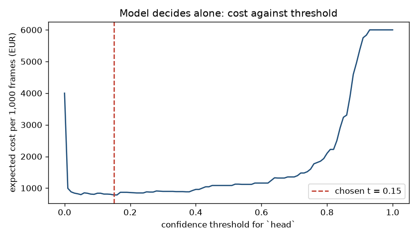

# Assignment 2 Report

- **Name**: Juan
- **Student ID**: 20007
- **Email**: jmunozq.ieu2022@student.ie.edu
- **Group**: BBADBA 5A

## Business problem, and the cost of being wrong

**The decision.** On a construction site, the safety coordinator (in Spain,
the *coordinador de seguridad y salud* or the contractor's *recurso
preventivo*) is responsible for making sure everyone in a hard-hat zone wears a
helmet. Today that is done by walking the site or watching CCTV. The model
looks at one CCTV frame and decides whether **anyone in view has a bare
head**. Each frame gets one of three outcomes:

- **Fail**: the supervisor is radioed and walks over to correct the worker.
- **Review**: a person (the site's CCTV guard or HSE assistant) looks at the
  frame and makes the call.
- **Pass**: nothing happens.

**Unit and positive class.** One case is one frame. The positive class is
`head`, meaning a visible head with no hard hat. A frame is positive if it
contains at least one `head`. The frame's score is the highest `head`
confidence the detector gives it. So a frame is judged by its most suspicious
person, which is the right rule for a safety decision.

**Why the two errors cost different amounts.**

- **False negative** (a bare head passes): a worker stays unprotected,
  nobody knows, and the risk lasts until someone else happens to notice. If
  that worker is hit, the employer faces the cost of the injury and, in Spain,
  liability for not enforcing PPE. That liability includes Labour Inspectorate
  sanctions and the *recargo de prestaciones* surcharge on Social Security
  benefits when the employer failed a safety measure. I price this at
  **€120 per missed frame** (derived below).
- **False positive** (an alert on a helmeted crew): the supervisor walks over,
  finds nothing, and loses about six minutes. I price this at **€4**.

A miss is therefore about **30 times** worse than a false alarm. This
asymmetry drives everything below:

- the metric I care about is recall on `head` frames, not accuracy;
- the cost-minimising threshold is low;
- the review band exists to catch the low-confidence bare heads that an
  automatic pass would let through.

## Dataset

- **Workspace / project / version:** `joseph-nelson` / `hard-hat-workers` /
  **version 5** (`raw_HeadHelmetClasses`).
- **Link:** <https://universe.roboflow.com/joseph-nelson/hard-hat-workers/dataset/5>
- **Use:** public domain, used as published (not forked).

**What one image is.** A photo of workers at a work site, with a box drawn
around every head. Each box is labelled `helmet` (hard hat on) or `head` (no
hard hat). The original dataset also has a `person` class. Version 5 omits
it, which suits this decision: a person box says nothing about compliance.

**Why this version.** Other versions of the same project do not serve the
decision.

- **v14** relabels every `helmet` as `head`, so compliant and non-compliant
  workers become the same class. I downloaded it first and rejected it once I
  saw `nc: 1`.
- **v8** and **v9** keep a single class only.

Version 5 has the two classes the decision needs and a 70/20/10
train/valid/test split, with no preprocessing or augmentation baked in. That
means the test split is untouched raw images.

**Does it serve the problem, or merely resemble it?** It serves the core
visual question: is there a hard hat on this head? But the images are
mostly ground-level, close-range photos, not elevated, wide-angle CCTV (see
the next section). It is the right labels on somewhat the wrong camera.

## What the dataset's composition implies

Computed from the label files by `train.py` (`artifacts/dataset_stats.json`):

| Split | Images | `head` boxes (images with one) | `helmet` boxes (images with one) | Frames with a bare head | Boxes / image |
|---|---|---|---|---|---|
| train | 4,916 | 4,612 (911) | 13,919 (4,503) | 18.5% | 3.8 |
| valid | 1,413 | 1,339 (256) | 3,913 (1,297) | 18.1% | 3.7 |
| test | 706 | 726 (140) | 1,915 (636) | 19.8% | 3.7 |

Object size: the median box side is **7.8% of the image side for `head`**
and **9.1% for `helmet`**. The 10th percentile is about 4.7%, and 11–15% of
boxes are under 5% of the image side. The median image is 500 × 333 px. I
trained at 416 px, so a typical head is about 33 px and the smallest tenth
are under 20 px.

What this implies:

1. **Class imbalance at box level, 3:1 helmet to head.** The averaged mAP is
   weighted toward the easy, plentiful class. I report `head` separately
   and treat it as the number that matters.
2. **At frame level, only 140 test frames contain a bare head.** Box counts
   (726) look comfortable, but the decision is made per frame, and each
   missed frame moves frame-level recall by 0.7 points. A measured miss rate
   of 6/140 = 4.3% has a 95% Wilson interval of roughly **2% to 9%**. The
   cost of a missed frame is the dominant term in every cost figure below,
   so **those costs carry that uncertainty**. They are good for ranking
   policies against each other, not as a forecast to the euro.
3. **The test split does not look like production.**
   - The images are web photos: close range, often posed, some with website
     watermarks, mostly daylight.
   - Fixed CCTV is elevated and wide, so heads would be smaller than the
     7.8% median here, and the footage includes night and rain.
   - The test split is also **20% positive**, against my assumed 5% on a
     managed site. I correct for the base rate explicitly (cost section).
   - I cannot correct for camera geometry. **These results do not establish
     how the model performs on real site CCTV.**
4. **Labels are noisy.** Inspecting the misses turned up at least one frame
   (`005939`) where four **red hard hats are labelled `head`**. Some measured
   misses, and some of the "false positive" heads, are therefore annotation
   errors, not model errors. I cannot say how many without relabelling.

## Finetuning and baselines

**Model.** Object detection with **yolo11n**, finetuned from the
COCO-pretrained checkpoint. I chose detection over classification because
the decision depends on finding a small bare head among several helmeted
ones. A whole-image classifier would have to learn that from about 30 px of
evidence, without being told where to look.

**Training.**
- **Hardware:** locally on an Apple M1 Pro, **on the CPU**.
- **Settings:** 40 epochs, imgsz 416, batch 32, AdamW (auto-selected,
  lr 0.00167), seed 0, deterministic, default Ultralytics augmentation
  (mosaic, flips, HSV), patience 15.
- **Convergence:** early stopping never triggered. The best validation
  epoch was the last one (val mAP50 0.963), so the model was still
  improving.
- **Time:** about 6.5 minutes per epoch while the machine was awake (22.8 h
  wall clock including sleep).

I first planned yolo11s on the Apple GPU (MPS), but training on MPS was
**broken**:

| Device | Box loss, from the same pretrained weights on the same 10% of images | Validation mAP50 after one full epoch |
|---|---|---|
| MPS | climbed from 2.04 to 2.84 | 0.00006 |
| CPU | stayed at 2.04 → 2.12 (no blow-up) | — |

The CPU-trained yolo11n reached 0.86 validation mAP50 after its first epoch,
so the MPS gradients on this torch 2.11 / Ultralytics 8.4 build cannot be
trusted. `train.py` now uses only CUDA or CPU. On CPU, yolo11s would have
taken about 13 h for 60 epochs, so I chose yolo11n at 40 epochs.

**Baselines on the same 706 test images, scored by the same code
(`evaluation.py`).**

1. **COCO yolo11n, zero-shot.** COCO has `person` but no helmet class, so it
   cannot tell compliant from non-compliant. I gave it its most generous
   reading: every detected person is treated as a possible bare head, and
   the box is shrunk to where the head would be.
2. **Trivial baseline: predict nothing.** At frame level this equals the
   majority class: every frame passes.

| Model | `head` AP50 | `helmet` AP50 | mAP50 | mAP50-95 | Frame recall | Frame precision | Frame accuracy | Cheapest cost, model decides alone |
|---|---|---|---|---|---|---|---|---|
| **Finetuned yolo11n** | **0.947** | **0.971** | **0.959** | **0.667** | 0.921 | 0.872 | 0.958 | **€783 / 1,000** (t = 0.15) |
| COCO yolo11n zero-shot | 0.078 | 0 (no such class) | 0.039 | 0.009 | 0.964 | 0.239 | 0.382 | €3,301 / 1,000 (t = 0.77) |
| Predict nothing / all pass | 0 | 0 | 0 | 0 | 0 | — | **0.802** | €6,000 / 1,000 |

The frame columns are at each model's own cost-minimising threshold. An
independent check with Ultralytics' own `val` on the test split gives mAP50
0.965 and mAP50-95 0.667, in line with my evaluator.

**Reading the table.**
- **The finetuned model beats both baselines on every measure that matters.**
- **The COCO model** has high frame recall only because it flags almost
  every frame with a person in it. Precision is 0.24, and three helmeted
  crews in four would trigger a supervisor visit.
- **The trivial baseline** scores 80% accuracy while catching no violations
  at all. That is why accuracy is not my headline metric.

The gap is as large as expected: zero-shot COCO has no concept of a helmet,
so it can only ever be a person detector.

## Per-class evaluation and failure modes

**Positive class:** `head`. Precision and recall are given at the cheapest
single threshold, conf 0.15, with box matches at IoU 0.5.

| Class | Test instances | AP50 | AP50-95 | Precision | Recall | TP / FP / FN |
|---|---|---|---|---|---|---|
| `head` (positive) | 726 | 0.947 | 0.661 | 0.827 | 0.952 | 691 / 145 / 35 |
| `helmet` | 1,915 | 0.971 | 0.673 | 0.855 | 0.966 | 1,850 / 313 / 65 |

**Box-level confusion matrix at conf 0.15** (class-agnostic matching, so a
class swap shows up as a confusion):

| predicted ↓ / true → | `head` | `helmet` | background |
|---|---|---|---|
| `head` | **687** | 7 | 142 |
| `helmet` | **18** | 1,845 | 300 |
| background (missed) | 21 | 63 | – |

**Which class carries the headline.** `helmet` has 2.6× more instances and
a higher AP, so it lifts the mean. `head`, the class the decision rests on,
is the weaker one at 0.947 AP50.

AP50-95 of about 0.66 for both classes shows that boxes are often loose on
small heads. That does not matter for the decision, which only needs to know
whether a bare head is present.

**The dangerous confusion is the 18 bare heads labelled `helmet`** (2.5% of
heads). Together with the 21 heads missed outright, those are the paths by
which a violation passes. The 142 `head` boxes with no matching label are
false alarms if the labels are right, but given the label noise found
below, some of them are probably unlabelled bare heads.

**Where it breaks, at frame level.** Six of the 140 bare-head test frames
score below 0.01, so the model sees essentially nothing. I inspected every
one:

| Frame | What is there | Failure type |
|---|---|---|
| `005300` | Driver with a bare head inside a wheel loader cab, small, behind glass | Inside a vehicle |
| `005465` | Worker bent over a foundation bolt, head seen from above at close range | Unusual pose |
| `005578` | Bare head squeezed between two helmeted workers, partly hidden | Occlusion |
| `005600` | Lineman on a pole, head turned away among helmeted colleagues | Pose / clutter |
| `005639` | Man in a felt brimmed hat | Non-hard-hat headwear |
| `005939` | Four red hard hats labelled `head` | **Label error, not a model error** |

Five more bare-head frames score between 0.01 and 0.15. These are caught
only because of the review band. They include `005447` (a grey-haired driver
inside an excavator cab) and `005986` (night, a dark hood).

The pattern is consistent. The model has learned "hard-hat shape on top of a
person". It fails when the head isn't seen from the usual angle (cabs,
bending, turned away), when it is covered by something that isn't a hard hat
(a felt hat, a hood), or when it is hidden among helmets.

## Cost matrix and operating point

All figures live in `costs.py`. Both the pipeline and the dashboard use them.

| Outcome | Cost | Where it comes from |
|---|---|---|
| **FN**, bare head passes | **€120** | The sum of two expected values. (1) **Injury:** a serious head injury costs the employer about €60,000 all-in (sick-pay top-up, investigation, replacement labour, higher mutual-insurer premium, and the 30–50% *recargo de prestaciones* when PPE was not enforced). I assume 1 in 1,000 uncorrected exposure episodes ends in such an injury, giving **€60**. (2) **Sanction:** a serious OHS infringement fine at the minimum grade under LISOS is in the low thousands of euros (about €2,450). I assume 1 uncorrected episode in 40 would be sanctioned if inspected, giving **about €60**. Both probabilities are order-of-magnitude assumptions, not measurements. |
| **FP**, false alert | **€4** | 6 minutes of a site supervisor at about €35/h loaded (€3.50) plus about €0.50 of crew interruption. Alarm fatigue is real but not priced. |
| **TP**, correct alert | **€4** | The same walk-over as an FP. The value of a TP is the €120 it avoids, which is already captured by not paying the FN cost. |
| **TN** | €0 | Nothing happens. |
| **Human review**, per frame | **€0.15** | 20 seconds of a CCTV guard or HSE assistant at about €27/h loaded. |
| **Reviewer accuracy** | 97% | Assumed. A reviewer misses 3% of real violations and wrongly flags 3% of clean frames. |

**Base rate: 5% of production frames contain a bare head.** I assumed this
because a site with an active safety coordinator should be mostly compliant.
Violations cluster around breaks, arrivals, heat, and people who "only
stepped in for a second". So 1 frame in 20 is plausible, and the test
split's 20% is not. Rates are measured per true class on the test split and
then reweighted to 5%. Cost per frame is:

> 5% × E[cost | bare head] + 95% × E[cost | compliant]

**Volume.** 25 cameras × 1 frame every 5 minutes × 10 h = **3,000 frames a
day**.

**Sweep with one threshold (the model decides alone)**, from 0 to 1 in steps
of 0.01:

The minimum is at **t = 0.15, €783 per 1,000 frames**. At that threshold:
- 7.9% of bare-head frames pass unnoticed;
- 3.4% of compliant frames trigger a walk-over.

Of the €783, misses account for about €475 (0.05 × 0.079 × €120 × 1,000).

**This is a finding, not a success.** At these costs, the model alone is
*more* expensive than having a person check every frame (€638). Misses are
so expensive that the 8% the model cannot see outweigh everything it gets
right. That is why the deliverable is the three-way band in the next
section, not a single threshold.

**The assumption that would most change the answer** is the €120 FN cost,
together with the base rate. From `artifacts/sensitivity.csv`:

| FN cost | Base rate | Best single t | Model alone | Person checks all | Best band (review share) |
|---|---|---|---|---|---|
| €30 | 5% | 0.37 | €400 | €503 | €314 (9%) |
| **€60** | 5% | 0.15 | **€548** | **€548** | €402 (14%) |
| €120 | 1% | 0.37 | €227 | €344 | €142 (7%) |
| **€120** | **5%** | **0.15** | **€783** | **€638** | €523 (95%) |
| €120 | 20% | 0.01 | €2,252 | €1,742 | €1,141 (81%) |
| €240 | 5% | 0.05 | €1,136 | €818 | €550 (94%) |

All costs are per 1,000 frames.

- **If a missed bare head costs less than about €60**, the model alone
  breaks even with checking everything.
- **At a 1% base rate**, the model alone wins outright, and the best
  single threshold rises to 0.37.
- **As misses get more expensive**, the best threshold falls toward zero.

In every row, a band with human review beats both the model alone and
checking everything.

## What a person still has to check

**Shipped thresholds:**
- **pass** below **t_low = 0.01**;
- **review** from 0.01 up to 0.68;
- **fail** at or above **t_high = 0.68**.

| Test frames | Pass | Review | Fail |
|---|---|---|---|
| Bare head in frame (140) | 6 (4.3%) | 21 (15.0%) | 113 (80.7%) |
| All helmeted (566) | 485 (85.7%) | 76 (13.4%) | 5 (0.9%) |

In words:
- Below 0.01 the model sees no head-like shape at all, and 86% of compliant
  frames pass with no human involved.
- From 0.68 the model is confident enough to radio the supervisor directly;
  only 5 of 566 compliant frames reach that level.
- Everything in between, where the review band catches 15% of the
  violations, goes to a person.

**Review load at the 5% base rate:**
- 13.5% of frames, i.e. **about 405 frames a day**;
- at 20 seconds each, **2.25 hours of review a day**;
- that is **0.38 of one reviewer**, with 6 productive hours per person per
  day.

**Is that realistic?** Yes. It fits inside the existing CCTV guard's shift
as one task among others.

The real constraint is **latency, not headcount**. A review is only useful
if it happens within minutes, while the worker is still there. That means
the queue has to be watched continuously: roughly 40 frames an hour, one
every 90 seconds, not batched at the end of the day. Load will also spike at
shift start and after breaks, when violations cluster.

**Why not the cheapest band overall?** The unconstrained optimum is
[0.00, 0.68), which reviews **95%** of frames for €523 per 1,000. I rejected
it.
- In practice, that band is "a person checks everything": 2.6 reviewers
  watching mostly empty frames all day.
- Low-prevalence monitoring of that kind is exactly where human attention
  fails, so the 97% reviewer accuracy it depends on will not hold.
- I therefore restricted the search to bands that **one reviewer** can
  handle, and the cheapest of those is the shipped band.

`train.py` reprices both bands as reviewer accuracy drops:

| Reviewer accuracy | Shipped band (13.5% reviewed) | Cheapest band (95% reviewed) | Person checks everything |
|---|---|---|---|
| 97% | €544 | €523 | €638 |
| 95% | **€571** | €621 | €830 |
| 93% | **€599** | €718 | €1,022 |
| 90% | **€640** | €865 | €1,310 |

The cheapest band wins only if reviewers keep 97% accuracy across 2,850
frames a day. One point of fatigue erases its €21 lead.

**Priced against the alternatives** (5% base rate, 3,000 frames a day):

| Policy | € / 1,000 frames | € / day | People needed | Bare-head frames that go unchecked |
|---|---|---|---|---|
| Do nothing (no monitoring) | €6,000 | €18,000 | 0 | 100% |
| Person checks every frame | €638 | €1,914 | 2.8 | 3% (reviewer misses) |
| Model decides alone (t = 0.15) | €783 | €2,350 | 0 | 7.9% |
| **Shipped band [0.01, 0.68)** | **€544** | **€1,631** | **0.38** | **4.3% pass outright + 3% of the 15% reviewed** |

The shipped band is the cheapest option that is realistic to staff. It
saves about €280 a day over checking everything and needs one person part
of the day instead of three full-time.

"Do nothing" looks catastrophic because it inherits the full FN assumption.
The ranking of the other three holds across the sensitivity table, but the
absolute euro figures depend on the €120.

## Limitations & next steps

1. **Domain shift from web photos to site CCTV.** This is the biggest
   limitation. Next step: collect 1–2 weeks of footage from the actual
   cameras, label a few hundred frames, finetune on them, and re-measure the
   pass-through rate before trusting t_low.
2. **Only 140 positive test frames.** The 4.3% pass-through rate could be
   anywhere from 2% to 9%. Next step: pool valid and test for the threshold
   study, or run a shadow period on live CCTV with every frame reviewed to
   get thousands of positives.
3. **Label noise.** Red hard hats are labelled `head`, and some
   false-positive heads are probably unlabelled bare heads. Next step:
   relabel the `head` class on test (726 boxes, a couple of hours) and
   re-score. Noisy labels currently make the model look *worse* on misses.
4. **Systematic blind spots:** vehicle cabs, bent-over or turned-away heads,
   soft hats and hoods. Next step:
   - mask cab regions per camera, which is also a policy question, since
     enclosed-cab drivers may not need a hard hat;
   - add targeted examples of soft headwear and night scenes to training.
5. **Consecutive frames are correlated.** A worker without a helmet appears
   in several frames, so a single miss is not always a missed episode. That
   would argue for a lower per-frame FN cost. But misses are correlated too:
   the same cab or pose is missed every time. Next step: aggregate to a
   per-track decision (track a person across frames) and cost at episode
   level.
6. **The cost and accuracy figures are assumptions.** The FN probabilities
   and the 97% reviewer accuracy are not measured. Next step:
   - log reviewer decisions against an audited sample to measure the real
     accuracy;
   - get the site's actual injury and sanction history from the safety
     department.
7. **The scores are not calibrated probabilities.** The thresholds are only
   valid for these weights and this preprocessing: single-frame inference
   at 416 px. Any retraining means re-running the sweep, which `main.py
   train` does automatically.
8. **Privacy.** CCTV of identifiable workers is personal data under GDPR. In
   Spain, LOPDGDD art. 89 requires workers to be informed of video
   monitoring. A deployment would need a DPIA, retention limits on reviewed
   frames, and works-council consultation before go-live.

## Generative AI use disclosure

I used Claude (Anthropic) through Claude Code to help write the pipeline,
the evaluation code, the dashboard and a first draft of this report:
`train.py`, `evaluation.py`, `costs.py` and `app.py`. I chose the problem
(hard-hat compliance) and where and how long to train. Claude proposed the
cost figures, the dataset version and the one-reviewer operating point, and I
reviewed and accepted them. I checked the numbers in this report against the
pipeline outputs in `artifacts/`.
